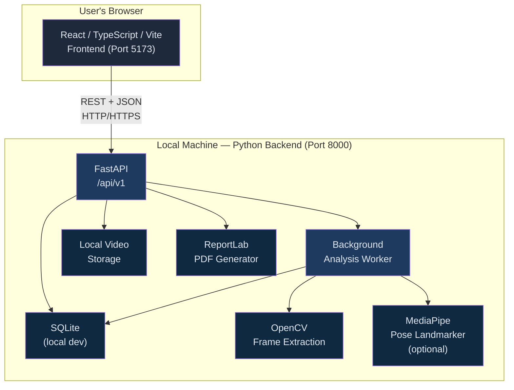
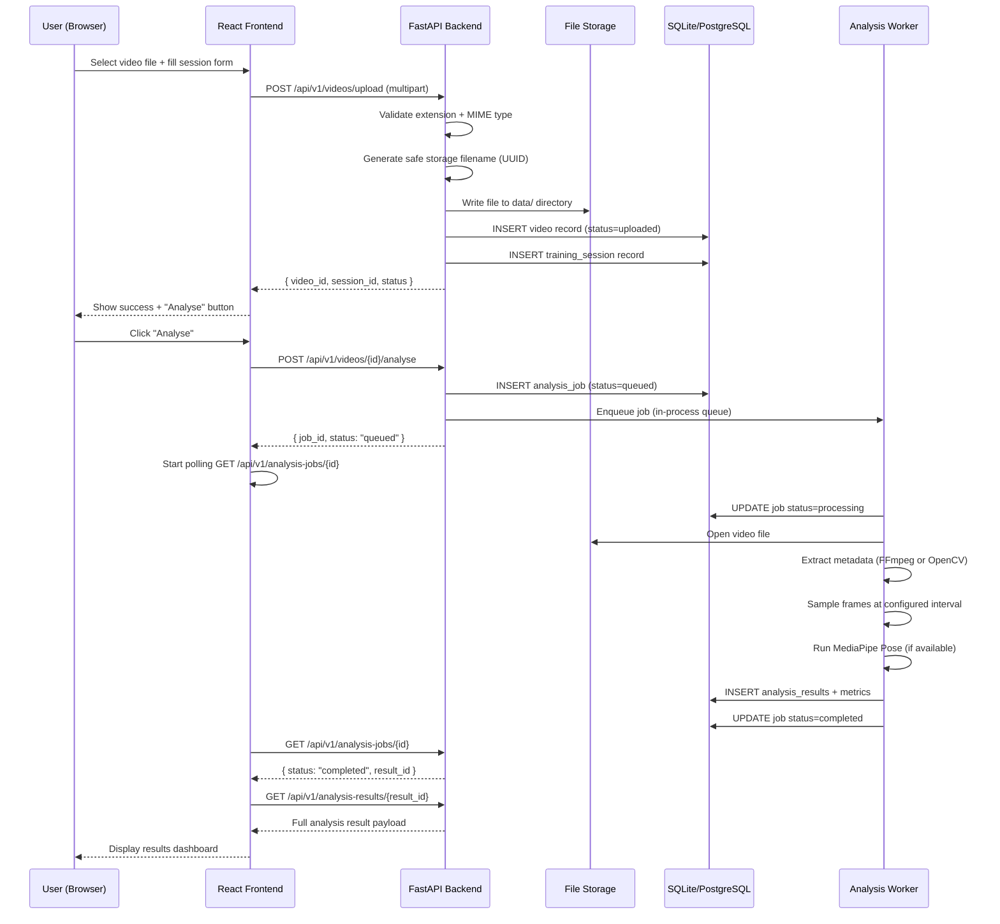
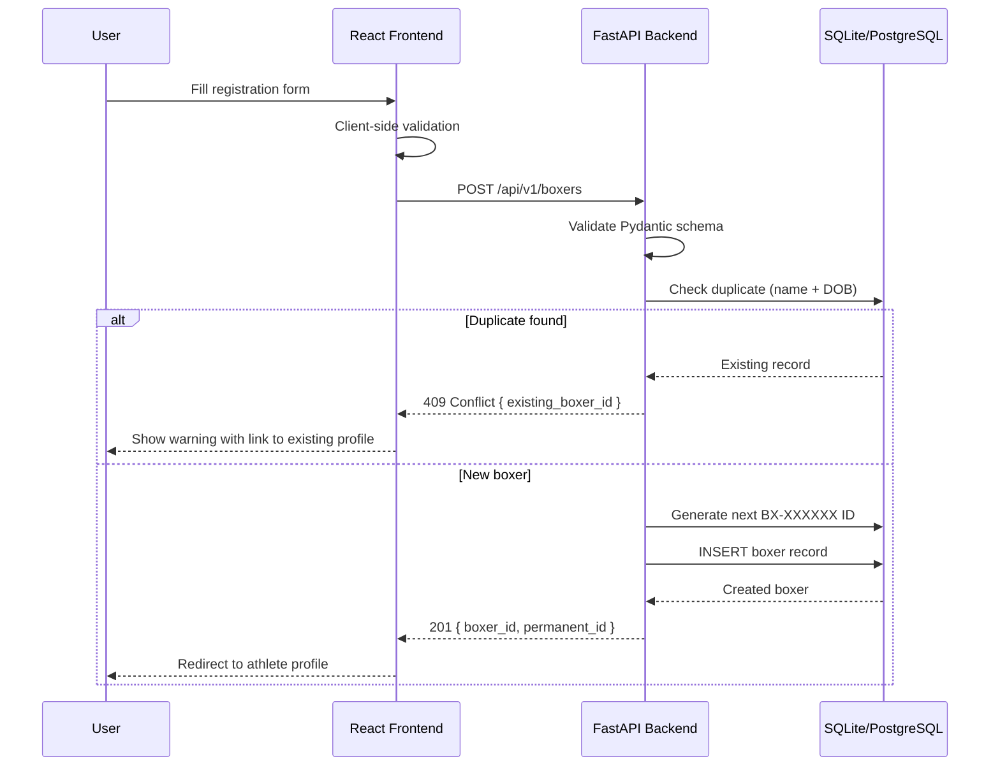
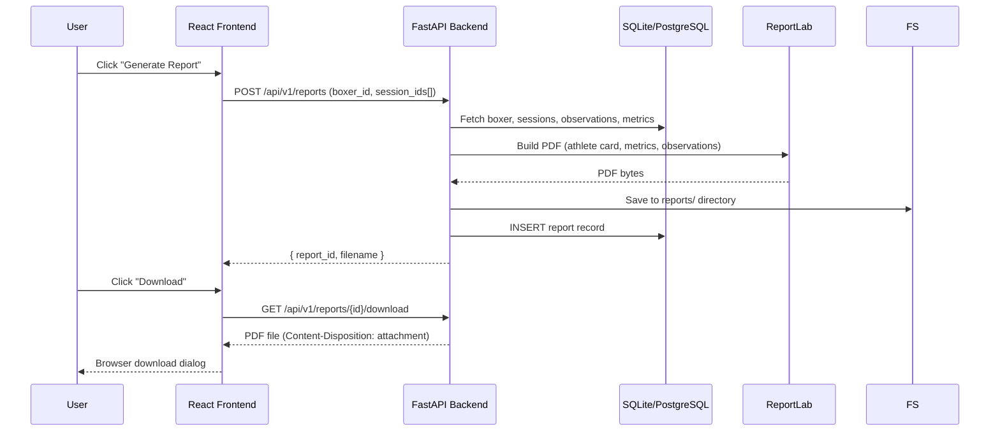

# Design Document: Valen Boxing Intelligence

*Developed by Valen Labs*

---

## Overview

Valen Boxing Intelligence is a video-based boxing performance analysis and athlete progress-tracking platform. Individual boxers and boxing gyms can register athletes, upload boxing footage, analyse training sessions, maintain permanent athlete records, compare progress across sessions, and generate professional PDF reports — all powered by a fully local video processing pipeline with no paid external AI APIs.

The system is a monorepo with a React/TypeScript/Vite frontend and a Python/FastAPI backend. Video analysis runs entirely on the local machine using OpenCV and optionally MediaPipe Pose Landmarker. The architecture is designed for local development with a clear deployment path: frontend to Vercel, backend to Render, SQLite locally / PostgreSQL in production.

All metrics displayed are derived exclusively from data the system can actually compute. The platform clearly labels unavailable metrics as unavailable and never fabricates results.

---

## Architecture

### System Context



### Monorepo Directory Structure

```
valen-boxing-intelligence/
├── frontend/
│   ├── src/
│   │   ├── api/          # Axios client + typed API helpers
│   │   ├── components/   # Shared UI components
│   │   ├── pages/        # Route-level page components
│   │   ├── hooks/        # Custom React hooks
│   │   ├── types/        # TypeScript interfaces matching API schemas
│   │   ├── utils/        # Formatting, date helpers
│   │   └── main.tsx
│   ├── .env.example
│   ├── vite.config.ts
│   └── package.json
├── backend/
│   ├── app/
│   │   ├── api/v1/       # FastAPI routers (boxers, camps, videos, etc.)
│   │   ├── core/         # Config, database, security helpers
│   │   ├── models/       # SQLAlchemy ORM models
│   │   ├── schemas/      # Pydantic request/response schemas
│   │   ├── services/     # Business logic layer
│   │   ├── analysis/     # Video processing pipeline modules
│   │   └── main.py
│   ├── data/             # Local video storage (gitignored)
│   ├── reports/          # Generated PDF reports (gitignored)
│   ├── tests/
│   ├── .env.example
│   ├── requirements.txt
│   ├── Dockerfile
│   └── render.yaml
└── docs/
    └── README.md
```

---

## Sequence Diagrams

### Video Upload and Analysis Flow



### Boxer Registration Flow



### PDF Report Generation Flow



---

## Components and Interfaces

### Frontend Components

#### `<BoxerCard />`

**Purpose**: Displays an athlete summary in directory listings and search results.

**Interface**:
```typescript
interface BoxerCardProps {
  boxer: BoxerSummary
  onClick: (boxerId: string) => void
}

interface BoxerSummary {
  id: string              // internal UUID
  permanentId: string     // BX-000001
  fullName: string
  weightClass: string
  stance: 'orthodox' | 'southpaw' | 'switch'
  experienceLevel: 'amateur' | 'semi-pro' | 'professional'
  primaryCoach: string
  registrationDate: string  // ISO 8601
  sessionCount: number
  latestSessionDate: string | null
  status: 'active' | 'archived'
}
```

#### `<VideoUploadForm />`

**Purpose**: Handles file selection, form capture, and upload progress.

**Interface**:
```typescript
interface VideoUploadFormProps {
  boxerId: string
  fightCamps: FightCampSummary[]
  onSuccess: (videoId: string, sessionId: string) => void
  onError: (error: UploadError) => void
}
```

**Responsibilities**:
- Validate file type client-side before upload
- Stream upload with `XMLHttpRequest` for progress events
- Disable submit during upload, show progress bar
- Surface backend validation errors clearly

#### `<AnalysisResultPanel />`

**Purpose**: Displays the structured output of a completed analysis job.

**Interface**:
```typescript
interface AnalysisResultPanelProps {
  jobId: string
  pollingIntervalMs?: number  // default 2000
}
```

**Responsibilities**:
- Poll job status until terminal state (completed / failed / cancelled)
- On completion, fetch and render analysis result
- Clearly label each metric with its source (automated / coach-entered)
- Show skeleton loaders during polling; error state on failure

#### `<ProgressChart />`

**Purpose**: Recharts line chart for session-by-session metric trends.

**Interface**:
```typescript
interface ProgressChartProps {
  series: MetricSeries[]
  metricLabel: string
  comparabilityWarnings: string[]
}

interface MetricSeries {
  sessionDate: string
  value: number
  sessionType: string
  sourceNote: string
}
```

#### `<ObservationTimeline />`

**Purpose**: Lists timestamped coach observations for a session, with navigation controls.

**Interface**:
```typescript
interface ObservationTimelineProps {
  observations: Observation[]
  currentVideoTime: number
  onSeek: (timestampSeconds: number) => void
  onAdd: (observation: NewObservation) => void
  onEdit: (id: string, updates: Partial<Observation>) => void
}
```

### Backend Services

#### `BoxerService`

**Purpose**: Business logic for athlete management, ID generation, duplicate detection.

**Interface**:
```python
class BoxerService:
    def create_boxer(self, db: Session, data: BoxerCreate) -> Boxer: ...
    def get_boxer(self, db: Session, boxer_id: str) -> Boxer | None: ...
    def list_boxers(self, db: Session, filters: BoxerFilters, 
                    page: int, page_size: int) -> PaginatedResult[Boxer]: ...
    def update_boxer(self, db: Session, boxer_id: str, 
                     data: BoxerUpdate) -> Boxer: ...
    def archive_boxer(self, db: Session, boxer_id: str) -> Boxer: ...
    def generate_permanent_id(self, db: Session) -> str: ...
    def check_duplicate(self, db: Session, 
                        name: str, dob: date) -> Boxer | None: ...
```

#### `VideoService`

**Purpose**: Safe file handling, storage, and video record management.

**Interface**:
```python
class VideoService:
    def save_upload(self, file: UploadFile, 
                    boxer_id: str) -> StoredVideo: ...
    def get_video(self, db: Session, video_id: str) -> Video | None: ...
    def validate_file(self, file: UploadFile) -> ValidationResult: ...
    def build_safe_path(self, storage_dir: Path, 
                        video_id: str, extension: str) -> Path: ...
    def delete_video(self, db: Session, video_id: str) -> None: ...
```

#### `AnalysisService`

**Purpose**: Orchestrates analysis job lifecycle and background dispatch.

**Interface**:
```python
class AnalysisService:
    def enqueue_job(self, db: Session, video_id: str,
                    config: AnalysisConfig) -> AnalysisJob: ...
    def get_job(self, db: Session, job_id: str) -> AnalysisJob | None: ...
    def cancel_job(self, db: Session, job_id: str) -> AnalysisJob: ...
    def get_result(self, db: Session, 
                   result_id: str) -> AnalysisResult | None: ...
```

#### `ReportService`

**Purpose**: Builds and stores PDF reports using ReportLab.

**Interface**:
```python
class ReportService:
    def generate_report(self, db: Session, 
                        request: ReportRequest) -> Report: ...
    def get_report_path(self, db: Session, 
                        report_id: str) -> Path | None: ...
    def list_reports(self, db: Session, 
                     boxer_id: str) -> list[Report]: ...
```

---

## Data Models

### Database Schema

```mermaid
erDiagram
    BOXERS {
        string id PK "UUID"
        string permanent_id UK "BX-000001"
        string full_name
        date date_of_birth
        string weight_class
        string stance
        string experience_level
        string primary_coach
        text training_goals
        text notes
        string status
        datetime created_at
        datetime updated_at
    }

    FIGHT_CAMPS {
        string id PK
        string boxer_id FK
        string name
        date target_fight_date
        date start_date
        date end_date
        string status
        text objectives
        text coach_notes
        datetime created_at
        datetime updated_at
    }

    TRAINING_SESSIONS {
        string id PK
        string boxer_id FK
        string fight_camp_id FK "nullable"
        string session_type
        date session_date
        integer rounds
        integer round_duration_seconds
        text objectives
        text coach_notes
        datetime created_at
    }

    VIDEOS {
        string id PK
        string boxer_id FK
        string session_id FK "nullable"
        string storage_filename
        string original_filename_safe
        string mime_type
        integer file_size_bytes
        string status
        datetime uploaded_at
    }

    ANALYSIS_JOBS {
        string id PK
        string video_id FK
        string status
        string config_json
        datetime queued_at
        datetime started_at
        datetime completed_at
        text error_message
    }

    ANALYSIS_RESULTS {
        string id PK
        string job_id FK
        string video_id FK
        float duration_seconds
        integer width_px
        integer height_px
        float fps
        integer total_frames
        integer sampled_frames
        boolean pose_available
        integer pose_detected_frames
        datetime analysed_at
    }

    METRICS {
        string id PK
        string result_id FK
        string boxer_id FK
        string session_id FK "nullable"
        string metric_key
        float value
        string unit
        string source
        string calculation_method
        datetime recorded_at
    }

    OBSERVATIONS {
        string id PK
        string video_id FK
        string boxer_id FK
        string session_id FK "nullable"
        float timestamp_seconds
        string category
        string description
        string severity
        text coach_notes
        string recommended_drill
        string review_status
        datetime created_at
        datetime updated_at
    }

    REPORTS {
        string id PK
        string boxer_id FK
        string storage_filename
        string title
        datetime generated_at
        text session_ids_json
    }

    BOXERS ||--o{ FIGHT_CAMPS : "has"
    BOXERS ||--o{ TRAINING_SESSIONS : "has"
    BOXERS ||--o{ VIDEOS : "has"
    BOXERS ||--o{ METRICS : "has"
    BOXERS ||--o{ OBSERVATIONS : "has"
    BOXERS ||--o{ REPORTS : "has"
    FIGHT_CAMPS ||--o{ TRAINING_SESSIONS : "contains"
    TRAINING_SESSIONS ||--o{ VIDEOS : "recorded in"
    VIDEOS ||--o{ ANALYSIS_JOBS : "processed by"
    ANALYSIS_JOBS ||--o| ANALYSIS_RESULTS : "produces"
    ANALYSIS_RESULTS ||--o{ METRICS : "yields"
    VIDEOS ||--o{ OBSERVATIONS : "annotated with"
```



### Pydantic Schemas (Backend)

```python
class BoxerCreate(BaseModel):
    full_name: str = Field(..., min_length=2, max_length=150)
    date_of_birth: date
    weight_class: str
    stance: Literal['orthodox', 'southpaw', 'switch']
    experience_level: Literal['amateur', 'semi-pro', 'professional']
    primary_coach: str = Field(..., max_length=150)
    training_goals: str | None = None
    notes: str | None = None

class BoxerResponse(BaseModel):
    id: str
    permanent_id: str
    full_name: str
    date_of_birth: date
    weight_class: str
    stance: str
    experience_level: str
    primary_coach: str
    training_goals: str | None
    notes: str | None
    status: str
    created_at: datetime
    updated_at: datetime

    model_config = ConfigDict(from_attributes=True)

class VideoUploadResponse(BaseModel):
    video_id: str
    session_id: str
    status: str
    original_filename_safe: str
    file_size_bytes: int
    uploaded_at: datetime

class AnalysisJobResponse(BaseModel):
    id: str
    video_id: str
    status: Literal['queued', 'processing', 'completed', 'failed', 'cancelled']
    queued_at: datetime
    started_at: datetime | None
    completed_at: datetime | None
    error_message: str | None
    result_id: str | None

class AnalysisResultResponse(BaseModel):
    id: str
    job_id: str
    video_id: str
    duration_seconds: float
    width_px: int
    height_px: int
    fps: float
    total_frames: int
    sampled_frames: int
    pose_available: bool
    pose_detected_frames: int
    metrics: list[MetricResponse]
    analysed_at: datetime

class ObservationCreate(BaseModel):
    video_id: str
    boxer_id: str
    session_id: str | None = None
    timestamp_seconds: float = Field(..., ge=0)
    category: Literal[
        'guard_position', 'stance_and_balance', 'footwork',
        'punch_execution', 'return_to_guard', 'defensive_movement',
        'timing_and_distance', 'conditioning_related', 'other'
    ]
    description: str = Field(..., min_length=5, max_length=1000)
    severity: Literal['low', 'medium', 'high'] = 'medium'
    coach_notes: str | None = None
    recommended_drill: str | None = None
    review_status: Literal['pending', 'reviewed', 'resolved'] = 'pending'
```

### TypeScript Types (Frontend)

```typescript
// Mirrors backend Pydantic schemas

export interface Boxer {
  id: string
  permanentId: string
  fullName: string
  dateOfBirth: string
  weightClass: string
  stance: 'orthodox' | 'southpaw' | 'switch'
  experienceLevel: 'amateur' | 'semi-pro' | 'professional'
  primaryCoach: string
  trainingGoals: string | null
  notes: string | null
  status: 'active' | 'archived'
  createdAt: string
  updatedAt: string
}

export interface FightCamp {
  id: string
  boxerId: string
  name: string
  targetFightDate: string | null
  startDate: string
  endDate: string | null
  status: 'planned' | 'active' | 'completed' | 'archived'
  objectives: string | null
  coachNotes: string | null
  createdAt: string
}

export interface AnalysisJob {
  id: string
  videoId: string
  status: 'queued' | 'processing' | 'completed' | 'failed' | 'cancelled'
  queuedAt: string
  startedAt: string | null
  completedAt: string | null
  errorMessage: string | null
  resultId: string | null
}

export interface AnalysisResult {
  id: string
  jobId: string
  videoId: string
  durationSeconds: number
  widthPx: number
  heightPx: number
  fps: number
  totalFrames: number
  sampledFrames: number
  poseAvailable: boolean
  poseDetectedFrames: number
  metrics: Metric[]
  analysedAt: string
}

export interface Metric {
  id: string
  metricKey: string
  value: number
  unit: string
  source: 'automated' | 'coach_entered'
  calculationMethod: string
  recordedAt: string
}

export interface Observation {
  id: string
  videoId: string
  boxerId: string
  sessionId: string | null
  timestampSeconds: number
  category: ObservationCategory
  description: string
  severity: 'low' | 'medium' | 'high'
  coachNotes: string | null
  recommendedDrill: string | null
  reviewStatus: 'pending' | 'reviewed' | 'resolved'
  createdAt: string
  updatedAt: string
}

export type ObservationCategory =
  | 'guard_position'
  | 'stance_and_balance'
  | 'footwork'
  | 'punch_execution'
  | 'return_to_guard'
  | 'defensive_movement'
  | 'timing_and_distance'
  | 'conditioning_related'
  | 'other'
```

---

## Algorithmic Pseudocode

### Video Analysis Pipeline

```python
# backend/app/analysis/pipeline.py

ALGORITHM run_analysis_pipeline(job_id: str, db: Session) -> None:
"""
Main entry point for background analysis. Updates job status throughout.
Preconditions:
  - job exists in DB with status='queued'
  - video file exists on disk at video.storage_filename
Postconditions:
  - job.status is 'completed' or 'failed'
  - If completed: analysis_result + metrics records inserted
  - If failed: job.error_message contains human-readable description
"""

BEGIN
  job = db.get(AnalysisJob, job_id)
  IF job IS None OR job.status != 'queued' THEN
    RETURN  # stale or invalid job, silently exit
  END IF

  UPDATE job.status = 'processing', job.started_at = now()
  COMMIT

  TRY
    video = db.get(Video, job.video_id)
    file_path = resolve_video_path(video.storage_filename)

    # Stage 1: Validate file
    ASSERT file_path.exists()
    ASSERT file_path.stat().st_size > 0

    # Stage 2: Extract metadata
    metadata = extract_video_metadata(file_path)
    # Returns: {duration, width, height, fps, frame_count}
    # Uses FFmpeg subprocess if available, falls back to OpenCV

    # Stage 3: Sample frames
    config = parse_config(job.config_json)
    frame_interval = config.frame_interval_seconds  # default 0.5s
    max_frames = config.max_frames  # default 500
    frames = sample_frames(file_path, frame_interval, max_frames)
    # frames: list of (timestamp_seconds, numpy_array)

    # Stage 4: Optionally run pose estimation
    pose_results = []
    pose_available = is_mediapipe_available()
    IF pose_available THEN
      FOR each (ts, frame) IN frames DO
        landmarks = run_pose_landmarker(frame)
        IF landmarks IS NOT None THEN
          pose_results.append({timestamp: ts, landmarks: landmarks})
        END IF
      END FOR
    END IF

    # Stage 5: Compute metrics (only from real data)
    metrics = compute_metrics(metadata, frames, pose_results)

    # Stage 6: Persist results
    result = AnalysisResult(
      job_id=job_id,
      video_id=video.video_id,
      duration_seconds=metadata.duration,
      width_px=metadata.width,
      height_px=metadata.height,
      fps=metadata.fps,
      total_frames=metadata.frame_count,
      sampled_frames=len(frames),
      pose_available=pose_available,
      pose_detected_frames=len(pose_results),
      analysed_at=now()
    )
    db.add(result)

    FOR each metric IN metrics DO
      db.add(Metric(result_id=result.id, boxer_id=video.boxer_id, ...))
    END FOR

    UPDATE job.status = 'completed', job.completed_at = now()
    COMMIT

  CATCH Exception AS e
    ROLLBACK
    UPDATE job.status = 'failed'
    UPDATE job.error_message = format_error(e)
    UPDATE job.completed_at = now()
    COMMIT
  END TRY
END
```

### Frame Sampling Algorithm

```python
ALGORITHM sample_frames(
    file_path: Path,
    interval_seconds: float,
    max_frames: int
) -> list[tuple[float, np.ndarray]]:
"""
Preconditions:
  - file_path points to a valid, readable video file
  - interval_seconds > 0
  - max_frames > 0
Postconditions:
  - Returns list of (timestamp, frame) tuples
  - len(result) <= max_frames
  - Timestamps are evenly spaced by interval_seconds
  - All frames are valid numpy arrays (decoded successfully)
Loop invariant:
  - All collected frames have been decoded without error
"""
BEGIN
  cap = cv2.VideoCapture(str(file_path))
  ASSERT cap.isOpened()

  fps = cap.get(cv2.CAP_PROP_FPS)
  total_frames = int(cap.get(cv2.CAP_PROP_FRAME_COUNT))
  frame_step = max(1, int(fps * interval_seconds))
  frames_to_sample = min(max_frames, total_frames // frame_step)

  collected = []
  target_frame = 0

  WHILE target_frame < total_frames AND len(collected) < max_frames DO
    # LOOP INVARIANT: all collected frames are valid decoded numpy arrays
    cap.set(cv2.CAP_PROP_POS_FRAMES, float(target_frame))
    success, frame = cap.read()

    IF success AND frame IS NOT None THEN
      timestamp = target_frame / fps
      collected.append((timestamp, frame))
    END IF

    target_frame += frame_step
  END WHILE

  cap.release()
  RETURN collected
END
```

### Permanent ID Generation

```python
ALGORITHM generate_permanent_id(db: Session) -> str:
"""
Generates the next sequential permanent boxer ID in format BX-XXXXXX.
Preconditions:
  - db is a valid open Session
Postconditions:
  - Returned ID has format BX-[6 digits zero-padded]
  - ID is unique (no existing boxer has this permanent_id)
  - Thread-safe: uses SELECT FOR UPDATE / DB-level sequence
"""
BEGIN
  # Use a DB-level counter table or MAX+1 within a transaction
  WITH db.begin():
    last = db.execute(
      SELECT MAX(permanent_id) FROM boxers
    ).scalar_one_or_none()

    IF last IS None THEN
      next_num = 1
    ELSE
      # Extract numeric part from "BX-000042" → 42
      next_num = int(last[3:]) + 1
    END IF

    RETURN f"BX-{next_num:06d}"
END
```

### Duplicate Boxer Detection

```python
ALGORITHM check_duplicate(
    db: Session,
    full_name: str,
    date_of_birth: date
) -> Boxer | None:
"""
Preconditions:
  - full_name is non-empty string
  - date_of_birth is a valid date
Postconditions:
  - Returns existing Boxer if name (case-insensitive) + DOB match
  - Returns None if no duplicate found
"""
BEGIN
  normalised_name = full_name.strip().lower()

  existing = db.execute(
    SELECT * FROM boxers
    WHERE LOWER(TRIM(full_name)) = :name
      AND date_of_birth = :dob
      AND status != 'archived'
    LIMIT 1
  , {name: normalised_name, dob: date_of_birth}).first()

  RETURN existing
END
```

### Metric Computation

```python
ALGORITHM compute_metrics(
    metadata: VideoMetadata,
    frames: list[tuple[float, ndarray]],
    pose_results: list[PoseResult]
) -> list[ComputedMetric]:
"""
CRITICAL HONESTY RULE: Only compute and return metrics for which we have
real data. Never fabricate or estimate values we cannot compute.

Preconditions:
  - metadata contains validated video properties
  - frames is a non-empty list of decoded frames
  - pose_results may be empty (if MediaPipe unavailable)
Postconditions:
  - All returned metrics include source and calculation_method
  - No metric value is invented or extrapolated beyond available data
"""
BEGIN
  metrics = []

  # Always available: video metadata
  metrics.append(Metric(
    key='video_duration_seconds',
    value=metadata.duration,
    unit='seconds',
    source='automated',
    method='video_metadata_extraction'
  ))
  metrics.append(Metric(
    key='video_fps',
    value=metadata.fps,
    unit='fps',
    source='automated',
    method='video_metadata_extraction'
  ))
  metrics.append(Metric(
    key='sampled_frame_count',
    value=len(frames),
    unit='frames',
    source='automated',
    method='frame_sampling'
  ))

  # Only available if pose ran successfully
  IF len(pose_results) > 0 THEN
    detection_rate = len(pose_results) / len(frames)
    metrics.append(Metric(
      key='pose_detection_rate',
      value=round(detection_rate, 4),
      unit='ratio',
      source='automated',
      method='mediapipe_pose_landmarker'
    ))

    # Compute symmetry index only if we have enough pose frames
    IF len(pose_results) >= 10 THEN
      symmetry = compute_stance_symmetry(pose_results)
      IF symmetry IS NOT None THEN
        metrics.append(Metric(
          key='stance_symmetry_index',
          value=symmetry,
          unit='ratio_0_to_1',
          source='automated',
          method='landmark_hip_shoulder_alignment'
        ))
      END IF
    END IF
  END IF

  RETURN metrics
END
```

---

## Key Functions with Formal Specifications

### `VideoService.build_safe_path()`

```python
def build_safe_path(
    self,
    storage_dir: Path,
    video_id: str,
    extension: str
) -> Path:
```

**Preconditions:**
- `storage_dir` is an existing absolute directory path
- `video_id` is a valid UUID string (no path separators)
- `extension` is a whitelisted extension: `.mp4`, `.mov`, `.avi`, `.mkv`

**Postconditions:**
- Returned path is `storage_dir / f"{video_id}{extension}"`
- Returned path does not traverse outside `storage_dir`
- `path.parent == storage_dir` (no subdirectory injection)

**Security invariant:**
- User-supplied filename is never used in path construction
- Only the sanitised UUID and validated extension are concatenated

### `AnalysisService.enqueue_job()`

```python
def enqueue_job(
    self,
    db: Session,
    video_id: str,
    config: AnalysisConfig
) -> AnalysisJob:
```

**Preconditions:**
- Video with `video_id` exists and has `status='uploaded'`
- No existing job for this video in `queued` or `processing` state

**Postconditions:**
- Returns a new `AnalysisJob` with `status='queued'`
- Background thread has been started to process the job
- Job record is committed to DB before function returns

### `ReportService.generate_report()`

```python
def generate_report(
    self,
    db: Session,
    request: ReportRequest
) -> Report:
```

**Preconditions:**
- `request.boxer_id` maps to an existing boxer
- All `request.session_ids` belong to the specified boxer
- At least one session has observations or analysis results

**Postconditions:**
- PDF file written to `reports/` directory
- Report record inserted to DB with path reference
- PDF content only includes data actually present in the DB
- No fabricated findings appear in the output

### `extract_video_metadata()`

```python
def extract_video_metadata(file_path: Path) -> VideoMetadata:
```

**Preconditions:**
- `file_path` exists and is readable
- File is a valid video container (MP4/MOV/AVI/MKV)

**Postconditions:**
- Returns `VideoMetadata` with: `duration > 0`, `width > 0`, `height > 0`, `fps > 0`, `frame_count > 0`
- If FFmpeg subprocess is available, it is preferred over OpenCV
- If both fail, raises `MetadataExtractionError` with descriptive message — never returns zeroed/null metadata silently

---

## API Design

### Route Structure

```
GET  /health

# Boxers
GET    /api/v1/boxers                    # paginated list + search
POST   /api/v1/boxers                    # register boxer
GET    /api/v1/boxers/{id}               # athlete profile
PUT    /api/v1/boxers/{id}               # update boxer
POST   /api/v1/boxers/{id}/archive       # archive (soft delete)

# Fight Camps
GET    /api/v1/boxers/{id}/fight-camps   # list by boxer
POST   /api/v1/fight-camps               # create fight camp
GET    /api/v1/fight-camps/{id}          # fight camp detail
PUT    /api/v1/fight-camps/{id}          # update fight camp

# Videos & Sessions
POST   /api/v1/videos/upload             # multipart upload
GET    /api/v1/videos/{id}               # video detail
DELETE /api/v1/videos/{id}               # delete video + file

# Analysis
POST   /api/v1/videos/{id}/analyse       # enqueue analysis job
GET    /api/v1/analysis-jobs/{id}        # job status (for polling)
GET    /api/v1/analysis-results/{id}     # full result
DELETE /api/v1/analysis-jobs/{id}        # cancel queued job

# Observations
GET    /api/v1/videos/{id}/observations  # list for video
POST   /api/v1/observations              # create observation
PUT    /api/v1/observations/{id}         # update observation
DELETE /api/v1/observations/{id}         # delete observation

# Progress
GET    /api/v1/boxers/{id}/progress      # metric trends
GET    /api/v1/boxers/{id}/sessions      # session history

# Reports
POST   /api/v1/reports                   # generate PDF report
GET    /api/v1/reports/{id}              # report metadata
GET    /api/v1/reports/{id}/download     # stream PDF file
GET    /api/v1/boxers/{id}/reports       # list boxer reports

# Settings / Data
GET    /api/v1/settings/storage          # storage usage info
POST   /api/v1/settings/export           # export all data
DELETE /api/v1/boxers/{id}/data          # GDPR-style full deletion
```

### Standard Response Envelopes

```python
# Success (single item)
{
  "data": { ...item... },
  "meta": null
}

# Success (paginated list)
{
  "data": [ ...items... ],
  "meta": {
    "page": 1,
    "page_size": 20,
    "total": 143,
    "total_pages": 8
  }
}

# Error
{
  "error": {
    "code": "BOXER_DUPLICATE",
    "message": "A boxer with this name and date of birth already exists.",
    "details": { "existing_boxer_id": "BX-000042" }
  }
}
```

---

## Example Usage

### Register a Boxer (Frontend → Backend)

```typescript
// frontend/src/api/boxers.ts
import { apiClient } from './client'
import type { Boxer, BoxerCreate } from '../types'

export async function registerBoxer(data: BoxerCreate): Promise<Boxer> {
  const response = await apiClient.post<{ data: Boxer }>('/boxers', data)
  return response.data.data
}

// frontend/src/pages/RegisterBoxer.tsx
const handleSubmit = async (formData: BoxerCreate) => {
  try {
    const boxer = await registerBoxer(formData)
    navigate(`/boxers/${boxer.id}`)
  } catch (error) {
    if (isApiError(error) && error.code === 'BOXER_DUPLICATE') {
      setDuplicateWarning(error.details.existing_boxer_id)
    } else {
      setFormError('Registration failed. Please try again.')
    }
  }
}
```

### Upload a Video with Progress

```typescript
// frontend/src/api/videos.ts
export function uploadVideo(
  file: File,
  metadata: SessionMetadata,
  onProgress: (pct: number) => void
): Promise<VideoUploadResponse> {
  return new Promise((resolve, reject) => {
    const formData = new FormData()
    formData.append('file', file)
    formData.append('metadata', JSON.stringify(metadata))

    const xhr = new XMLHttpRequest()
    xhr.open('POST', `${API_BASE}/api/v1/videos/upload`)

    xhr.upload.addEventListener('progress', (e) => {
      if (e.lengthComputable) onProgress((e.loaded / e.total) * 100)
    })

    xhr.onload = () => {
      if (xhr.status === 201) resolve(JSON.parse(xhr.responseText).data)
      else reject(JSON.parse(xhr.responseText).error)
    }

    xhr.onerror = () => reject({ code: 'NETWORK_ERROR', message: 'Upload failed' })
    xhr.send(formData)
  })
}
```

### Poll Analysis Job Until Complete

```typescript
// frontend/src/hooks/useAnalysisJob.ts
export function useAnalysisJob(jobId: string | null) {
  const [job, setJob] = useState<AnalysisJob | null>(null)

  useEffect(() => {
    if (!jobId) return
    let cancelled = false

    const poll = async () => {
      while (!cancelled) {
        const j = await getAnalysisJob(jobId)
        setJob(j)
        if (['completed', 'failed', 'cancelled'].includes(j.status)) break
        await sleep(2000)
      }
    }

    poll()
    return () => { cancelled = true }
  }, [jobId])

  return job
}
```

### Run Analysis Pipeline (Backend)

```python
# backend/app/analysis/runner.py
import threading

def run_in_background(job_id: str, db_url: str) -> None:
    """Runs in a daemon thread; creates its own DB session."""
    from sqlalchemy import create_engine
    from sqlalchemy.orm import sessionmaker

    engine = create_engine(db_url)
    SessionLocal = sessionmaker(bind=engine)
    db = SessionLocal()

    try:
        run_analysis_pipeline(job_id, db)
    finally:
        db.close()

def start_analysis_job(job_id: str, settings: Settings) -> None:
    thread = threading.Thread(
        target=run_in_background,
        args=(job_id, settings.database_url),
        daemon=True,
        name=f"analysis-{job_id[:8]}"
    )
    thread.start()
```

---

## Correctness Properties

*A property is a characteristic or behavior that should hold true across all valid executions of a system — essentially, a formal statement about what the system should do. Properties serve as the bridge between human-readable specifications and machine-verifiable correctness guarantees.*

### Property 1: Permanent ID format and uniqueness

*For any* sequence of boxer registrations, every generated `permanent_id` must match the regex `^BX-\d{6}$`, be unique across all existing records, and be numerically greater than all previously generated IDs.

**Validates: Requirements 1.1, 1.2**

---

### Property 2: Duplicate detection is case-insensitive

*For any* existing active boxer record with a given `full_name` and `date_of_birth`, registering a new boxer with the same `date_of_birth` and any casing variant of `full_name` must return a 409 Conflict response containing the original boxer's `id`.

**Validates: Requirement 1.3**

---

### Property 3: Archived boxer does not block re-registration

*For any* boxer record with `status=archived`, registering a new boxer with the same `full_name` and `date_of_birth` must succeed (201 Created) rather than returning a 409 Conflict.

**Validates: Requirement 1.10**

---

### Property 4: Schema field validation rejects out-of-range and out-of-set values

*For any* boxer registration request where `full_name` has length < 2 or > 150, or `stance` is not in `{orthodox, southpaw, switch}`, or `experience_level` is not in `{amateur, semi-pro, professional}`, the Backend must return a 422 Unprocessable Entity response.

**Validates: Requirements 1.5, 1.6, 1.7**

---

### Property 5: Paginated list size invariant

*For any* `page` and `page_size` parameters passed to a list endpoint, the number of items in `data` must be less than or equal to `page_size`, and `meta.total` must equal the true count of all matching records.

**Validates: Requirements 2.5, 10.4**

---

### Property 6: Fight camp session isolation

*For any* training session `s` and fight camp `c` where `s.boxer_id ≠ c.boxer_id`, any request to link `s` to `c` must be rejected with a 422 error; the session's `fight_camp_id` must remain unchanged.

**Validates: Requirement 3.2**

---

### Property 7: Fight camps are returned in descending start_date order

*For any* boxer with any number of fight camps, the list returned by `GET /api/v1/boxers/{id}/fight-camps` must be ordered by `start_date` descending.

**Validates: Requirement 3.4**

---

### Property 8: Video upload validation rejects invalid extension or MIME type

*For any* uploaded file whose extension is not in `{.mp4, .mov, .avi, .mkv}` or whose MIME type is inconsistent with its extension, the Backend must return a 422 response with `code: VIDEO_INVALID_TYPE` and must not write any data to `Storage_Dir`.

**Validates: Requirements 4.1, 4.2**

---

### Property 9: Oversized uploads are rejected before writing to disk

*For any* upload request where the declared or received file size exceeds the configured maximum, the Backend must return an error response and `Storage_Dir` must contain no new file.

**Validates: Requirement 4.4**

---

### Property 10: Safe path construction — user input isolation and directory confinement

*For any* video upload with an arbitrary `original_filename` and any valid UUID `video_id`, (a) the resulting `storage_filename` must not contain any substring from the original user-supplied filename, and (b) `build_safe_path(storage_dir, video_id, ext).parent` must equal `storage_dir`.

**Validates: Requirements 5.1, 5.2**

---

### Property 11: Deleted video removes both DB record and file

*For any* video that has been successfully deleted via `DELETE /api/v1/videos/{id}`, both the database record and the file at `Storage_Dir/{storage_filename}` must be absent.

**Validates: Requirement 4.9**

---

### Property 12: Analysis job enqueue idempotency

*For any* video that already has an Analysis_Job in `queued` or `processing` state, calling `enqueue_job` again for that video must raise an error and must not create a duplicate job record.

**Validates: Requirement 6.2**

---

### Property 13: Analysis job terminal state immutability

*For any* Analysis_Job in a terminal state (`completed`, `failed`, or `cancelled`), any subsequent attempt to transition the job's status must have no effect; the job must remain in its terminal state with `completed_at` already set.

**Validates: Requirement 6.4**

---

### Property 14: Video metadata postconditions

*For any* valid video file, `extract_video_metadata` must return a `VideoMetadata` object where all of `duration`, `width`, `height`, `fps`, and `frame_count` are strictly greater than zero.

**Validates: Requirement 6.6**

---

### Property 15: Frame sampling count invariant

*For any* combination of `interval_seconds > 0`, `max_frames > 0`, and a valid video file, the number of sampled frames returned by `sample_frames` must be less than or equal to `max_frames`, and every element must be a successfully decoded numpy array.

**Validates: Requirement 6.8**

---

### Property 16: Metric honesty invariant

*For any* call to `compute_metrics` with any valid `(metadata, frames, pose_results)` inputs, every returned metric must have `source ∈ {automated, coach_entered}` and a non-empty `calculation_method`; no metric value may be fabricated or estimated beyond the provided data.

**Validates: Requirements 7.1, 7.2**

---

### Property 17: Polling cleanup on unmount

*For any* `useAnalysisJob` hook instance that is unmounted at any point in the polling lifecycle, no further calls to the analysis job API endpoint must be made after the cleanup function runs.

**Validates: Requirement 8.5**

---

### Property 18: Observation validation rejects invalid fields

*For any* observation creation request where `timestamp_seconds < 0`, or `description` length is outside `[5, 1000]`, or `category` is not in the allowed set, or `severity` is not in `{low, medium, high}`, the Backend must return a 422 response.

**Validates: Requirements 9.1, 9.3, 9.4**

---

### Property 19: Observation timeline is sorted by timestamp ascending

*For any* set of observations attached to a video, the `ObservationTimeline` component must render them in ascending `timestamp_seconds` order.

**Validates: Requirement 9.6**

---

### Property 20: Session history is returned in descending session_date order

*For any* boxer with any number of training sessions, the list returned by `GET /api/v1/boxers/{id}/sessions` must be ordered by `session_date` descending.

**Validates: Requirement 10.4**

---

### Property 21: Report session ownership

*For any* report generation request containing a `session_id` that belongs to a different boxer than `boxer_id`, the Backend must return a 422 error and must not generate or persist a PDF.

**Validates: Requirement 11.1**

---

### Property 22: Report honesty invariant

*For any* generated PDF report, every data item in the report (observation text, metric value, session date) must correspond to a database record linked to the specified boxer; no section may be populated with synthetic or inferred data absent from the DB.

**Validates: Requirements 11.3, 11.4**

---

### Property 23: API success envelope shape — single item

*For any* successful API request to a single-item endpoint, the response JSON must match the shape `{ "data": { ... }, "meta": null }`.

**Validates: Requirement 12.1**

---

### Property 24: API success envelope shape — paginated list

*For any* successful API request to a paginated list endpoint, the response JSON must match the shape `{ "data": [...], "meta": { "page", "page_size", "total", "total_pages" } }`.

**Validates: Requirement 12.2**

---

### Property 25: API error envelope shape — no stack traces

*For any* API error response, the response JSON must match the shape `{ "error": { "code", "message", "details" } }` and must not contain a `traceback` or `stack_trace` field.

**Validates: Requirement 12.3**

---

### Property 26: Pydantic schema round-trip

*For any* valid instance of any Pydantic response schema, serialising to a dict via `model_dump()` and then reconstructing via `Model(**data)` must produce an object that is equivalent to the original.

**Validates: Requirement 14.3**

---

### Property 27: Pydantic schema rejects invalid payloads

*For any* Pydantic schema and any payload missing a required field or violating a declared constraint (type, length, literal set), constructing the model must raise a `ValidationError`.

**Validates: Requirement 14.4**

---

## Error Handling

### Scenario 1: Video File Upload — Type Rejected

**Condition**: User uploads a `.exe` or unsupported file type.
**Response**: `422 Unprocessable Entity` with `code: VIDEO_INVALID_TYPE` and list of accepted types.
**Recovery**: Frontend shows file-type error inline; upload form remains active.

### Scenario 2: Analysis Job — MediaPipe Unavailable

**Condition**: `mediapipe` package not installed or model file missing.
**Response**: Analysis completes with `pose_available: false`; pose-dependent metrics absent from results.
**Recovery**: Frontend shows banner: "Pose analysis unavailable — install MediaPipe for advanced metrics." Video metadata metrics are still displayed.

### Scenario 3: Analysis Job — Video File Corrupt / Unreadable

**Condition**: OpenCV cannot open the file; `cap.isOpened()` returns false.
**Response**: Job transitions to `failed`; `error_message` = "Video file could not be opened. The file may be corrupt or in an unsupported codec."
**Recovery**: Frontend shows error card with job failure message; user can re-upload.

### Scenario 4: Report Generation — No Observations or Results

**Condition**: Session has no coach observations and no completed analysis job.
**Response**: `422` with `code: REPORT_INSUFFICIENT_DATA` — report cannot be generated without at least one data source.
**Recovery**: Frontend disables "Generate Report" button with tooltip explaining requirement.

### Scenario 5: Duplicate Boxer Registration

**Condition**: `POST /api/v1/boxers` matches existing boxer by name + DOB.
**Response**: `409 Conflict` with `code: BOXER_DUPLICATE`, includes `existing_boxer_id`.
**Recovery**: Frontend shows warning with link to existing profile; user can proceed to that profile.

### Scenario 6: FFmpeg Not Available

**Condition**: `ffprobe` subprocess not found on PATH.
**Response**: `extract_video_metadata` falls back to OpenCV. Backend logs a `WARNING` level notice. Metadata extraction continues; `GET /health` response includes `{ "ffmpeg_available": false }`.
**Recovery**: No user-facing error; health endpoint surfaced in Settings page.

---

## Testing Strategy

### Unit Testing Approach

Test framework: `pytest` (backend), `Vitest` (frontend).

Key unit tests:
- `generate_permanent_id`: sequential, zero-padded, no collisions under concurrent calls
- `check_duplicate`: case-insensitive name matching, archived boxer not flagged as duplicate
- `build_safe_path`: path traversal attempts rejected, UUID-only filenames produced
- `compute_metrics`: returns only available metrics, no fabricated values
- `sample_frames`: respects `max_frames` cap, returns empty list for zero-length video
- `BoxerCreate` schema: rejects empty names, invalid stances, future DOBs

### Property-Based Testing Approach

**Property Test Library**: `hypothesis` (Python backend)

Key properties to verify:
- `generate_permanent_id` always produces strings matching `^BX-\d{6}$`
- `build_safe_path` for any UUID input: parent of result equals `storage_dir`
- `compute_metrics` for any valid `(metadata, frames, pose_results)`: all returned metrics have non-empty `source` and `calculation_method`
- JSON round-trip: all Pydantic schema instances serialise and deserialise without data loss

### Integration Testing Approach

- Full registration → profile → fight camp → upload → analysis → report flow using test DB
- Synthetic test video generator script (`tests/fixtures/generate_test_video.py`) produces minimal valid MP4s using OpenCV without external files
- API error responses use correct HTTP status codes and error envelopes
- Database schema initialisation is idempotent (safe to run `init_db()` twice)

---

## Performance Considerations

- Frame sampling with configurable `max_frames` (default 500) prevents runaway memory on long videos
- Analysis runs in a daemon thread — API remains responsive during processing
- Polling interval of 2 seconds is sufficient for job status; no WebSocket required for MVP
- SQLite with WAL mode for local dev supports concurrent reads during analysis writes
- PDF generation is synchronous but fast (< 1s for typical reports); acceptable for MVP
- Large video files: validate size limit (default 2 GB) at upload start before writing to disk

---

## Security Considerations

- **Path traversal**: All video file paths built from `uuid4()` + whitelisted extension only; user filenames logged but never used in FS operations
- **Upload validation**: Extension allowlist + MIME type check + file size limit enforced server-side
- **SQL injection**: All queries via SQLAlchemy ORM with parameterised bindings; no raw string interpolation
- **CORS**: `allow_origins` sourced from `CORS_ORIGINS` env var; defaults to `localhost:5173` in development
- **Secrets**: `SECRET_KEY`, `DATABASE_URL` only in `.env`; `.gitignore` covers `.env`, `data/`, `reports/`, `*.db`, `venv/`
- **Video access**: Videos served only after DB record verified to belong to requester (future auth gate)
- **Error messages**: Stack traces never exposed in production responses; structured error envelope only

---

## Dependencies

### Backend (`requirements.txt`)

```
fastapi>=0.111.0
uvicorn[standard]>=0.29.0
sqlalchemy>=2.0.0
pydantic>=2.0.0
pydantic-settings>=2.0.0
python-multipart>=0.0.9
aiofiles>=23.0.0
opencv-python-headless>=4.9.0
reportlab>=4.0.0
alembic>=1.13.0
psycopg2-binary>=2.9.0
pytest>=8.0.0
hypothesis>=6.100.0
httpx>=0.27.0

# Optional — install separately if needed:
# mediapipe>=0.10.0
# ffmpeg-python>=0.2.0
```

### Frontend (`package.json` key dependencies)

```json
{
  "react": "^18.3.0",
  "react-dom": "^18.3.0",
  "react-router-dom": "^6.23.0",
  "typescript": "^5.4.0",
  "vite": "^5.2.0",
  "tailwindcss": "^3.4.0",
  "axios": "^1.7.0",
  "recharts": "^2.12.0",
  "lucide-react": "^0.378.0",
  "vitest": "^1.6.0",
  "@testing-library/react": "^16.0.0"
}
```
